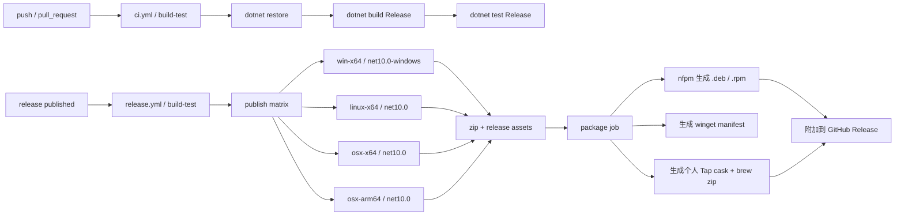

# 发布说明

## 发布流程

GitHub Actions 拆成两个 workflow：

- `.github/workflows/ci.yml`：`push` / `pull_request` 到 `master` 时跑 `build-test`
- `.github/workflows/release.yml`：`release: published` 时跑 `build-test` → `publish` → `package` → feeds / 个人 Tap / winget



- `publish` job 仍然是唯一构建来源，先生成各平台 `dotnet publish` 目录与 zip。
- `package` job 仅在 GitHub Release 触发时运行，复用现有 artifacts 继续产出：
  - `EarthBackground-<version>-linux-x64.deb`
  - `EarthBackground-<version>-linux-x64.rpm`
  - `dist/winget/...` 下的 `winget` manifest
  - `dist/homebrew-tap/Casks/earthbackground.rb`：个人 Tap 的 Cask
  - `dist/packages/apt` 与 `dist/packages/yum` 下的仓库元数据
- `publish-package-feeds` 会把 `.deb` / `.rpm` 及其索引同步到仓库 `gh-pages` 分支：
  - `https://<owner>.github.io/<repo>/packages/apt`
  - `https://<owner>.github.io/<repo>/packages/yum`
- `apt` 仓库会由 `apt-ftparchive` 生成 `Packages` / `Packages.gz` / `Release`，并在配置签名密钥后额外生成 `InRelease` / `Release.gpg`。
- `yum` 仓库元数据由 `createrepo_c` 生成；配置签名密钥后会额外生成 `repodata/repomd.xml.asc`。
- 仓库签名为可选启用，需配置以下 secrets：
  - `PACKAGE_FEED_GPG_PRIVATE_KEY`：ASCII armored 私钥
  - `PACKAGE_FEED_GPG_PASSPHRASE`：私钥口令
  - `PACKAGE_FEED_GPG_KEY_ID`：可选，指定签名 key id
- `publish-homebrew-tap` 使用本仓库的 `GITHUB_TOKEN`，将 Cask 更新到默认分支的 `Casks/earthbackground.rb`，不再向 Homebrew 官方仓库提交 PR。
- `publish-winget` 在配置 `secrets.WINGET_PAT` 后自动向 `winget-pkgs` 提交更新。

## 官方仓库与自建仓库建议

### Homebrew

- 本仓库同时作为个人 Tap，入口为 `lginc/earthbackground`，首次添加时需指定本仓库 URL，命令见下方安装示例。
- release 后生成 `dist/homebrew-tap/Casks/earthbackground.rb`，再由 `publish-homebrew-tap` 普通推送到默认分支；无需另建 Tap 仓库或配置跨仓库 PAT。
- macOS release 会把 `dotnet publish` 输出重新打包为标准 `EarthBackground.app` bundle，并同时生成 `.app.zip` 与 `.dmg`。
- 构建脚本会优先尝试从现有 `earth.ico` 自动生成 `EarthBackground.icns`；若 runner 上图标转换失败，仍会保留 `.app`，但缺少标准图标资源。
- Cask 使用 `depends_on :macos`，下载 URL 的 release 标签与文件名均保留 Ruby `#{version}` 插值；生成器也保留无 `v` 前缀标签的格式。
- `.github/workflows/homebrew.yml` 在 ARM64 与 Intel macOS Runner 上分别执行 style、online audit、安装、GUI 窗口检查和卸载/zap，并上传截图及路径证据。前一检查失败不会阻止后续可执行的验证，但 workflow 仍会报告失败。
- 当前发行包未做 Developer ID 签名和 Apple 公证。不会通过关闭 Gatekeeper、移除隔离属性或跳过安全审计来伪造验证成功。
- 官方仓库收录与个人 Tap 分发是两件事；当前不自动重提被关闭的官方 PR。

### APT / Debian / Ubuntu

- 当前仓库已经具备 **自建 APT 仓库** 所需的 `.deb`、索引、签名能力。
- 但这不等于已经满足 Debian / Ubuntu **官方仓库**收录要求。
- 官方发行仓库通常还需要：
  - 更标准的 Debian 打包流程
  - 符合 Debian Policy 的源码包与元数据
  - 持续维护和审核流程

结论：

- 现阶段更适合继续维护 **自建 APT 仓库**
- 不建议把 Debian / Ubuntu 官方仓库作为近期目标

### YUM / Fedora / EPEL

- 当前仓库已经具备 **自建 RPM 仓库** 所需的 `.rpm`、`createrepo_c` 元数据和可选签名。
- 但要进入 Fedora / EPEL 等官方生态，通常还需要：
  - 符合发行版规范的 RPM 打包维护方式
  - 更完整的 spec / source package 维护流程
  - 审核、许可、依赖、更新节奏等长期维护要求

结论：

- 现阶段更适合继续维护 **自建 RPM 仓库**
- Fedora / EPEL 官方仓库更适合作为后续成熟阶段目标

### 当前建议路线

按投入产出比，推荐顺序：

1. Homebrew：维护本仓库的个人 Tap，验证通过后分发
2. APT：持续维护自建仓库
3. YUM：持续维护自建仓库

## 维护者发布手册

### 一次性准备

1. 启用 GitHub Releases。
2. 启用 GitHub Pages，并将发布源指向 `gh-pages` 分支。
3. 允许本仓库 GitHub Actions 写入 `contents`，并确保默认分支规则允许 `publish-homebrew-tap` 推送 Cask 更新。
   - Tap 与应用共用当前仓库，无需创建官方 fork，也无需新增 PAT。
   - 默认分支的 `Casks/earthbackground.rb` 是用户安装入口，release artifact 不是 Tap 的替代品。
4. 如需 winget 自动提交：
   - 配置 `WINGET_PAT`
5. 如需 APT / YUM 仓库签名：
   - `PACKAGE_FEED_GPG_PRIVATE_KEY`
   - `PACKAGE_FEED_GPG_PASSPHRASE`
   - 需要时配置 `PACKAGE_FEED_GPG_KEY_ID`
6. 当前 workflow 不再包含 macOS 签名与公证步骤。
   - 无 Apple Developer 账号时，release 仍会生成可分发的 `.app.zip` 与 `.dmg`
   - 但不会执行 `codesign`、`notarytool`、`stapler`

### 首次初始化建议

- 若仓库此前没有 `gh-pages` 分支，建议先手工创建一个空分支。
- 先手工创建一次 GitHub Release，确认：
  - release zip 已上传
  - `gh-pages/packages/apt` 与 `gh-pages/packages/yum` 已生成
  - 默认分支的 `Casks/earthbackground.rb` 已更新
  - `EarthBackground-packages-<sha>` artifact 中包含 `dist/homebrew-tap/Casks/earthbackground.rb`
  - `publish-homebrew-tap` 显示提交已推送，或明确显示 Cask 无变更

### 每次 release 后检查

- GitHub Release 附件中应包含：
  - Windows / Linux zip
  - macOS zip（其中应包含 `EarthBackground.app`）
  - macOS `.dmg`
  - `.deb`
  - `.rpm`
  - `EarthBackground-<version>-osx-arm64-brew.zip`
- macOS release 当前会生成未签名、未公证的 `.app` 与 `.dmg`
- `gh-pages` 分支中应包含：
  - `packages/apt/Packages`
  - `packages/apt/Packages.gz`
  - `packages/apt/Release`
  - 签名启用时：`packages/apt/InRelease`、`packages/apt/Release.gpg`
  - `packages/yum/repodata/`
  - 签名启用时：`packages/yum/repodata/repomd.xml.asc`
  - 签名启用时：`packages/public.key`
- 若启用了 Homebrew / winget 自动发布，再分别检查个人 Tap 的 Cask 更新和 winget PR 状态。

### 常见失败与排查

#### `publish-package-feeds` 失败

- 现象：无法 push 到 `gh-pages`，或 `packages/apt`、`packages/yum` 没有更新。
- 优先检查：
  - `gh-pages` 分支是否存在
  - 仓库是否允许 GitHub Actions 写入 `contents`
  - GitHub Pages 是否已指向 `gh-pages`

#### Homebrew 验证与个人 Tap 发布失败

- 当前版本的 Cask 位于默认分支 `Casks/earthbackground.rb`；release 生成器位于 `.github/workflows/release.yml`。
- `.github/workflows/homebrew.yml` 可手工运行，也会在 Cask 或其验证 workflow 变更时运行；覆盖 `macos-latest`（ARM64）与 `macos-15-intel`。
- 真实 macOS 验证不得只看构建成功：需要确认 style、online audit、安装、应用窗口、卸载/zap 的每一步结果，并查看 `homebrew-<runner>` artifact 中的截图和路径记录。
- 如 audit 或启动被 Gatekeeper 拒绝，记录原始失败；Developer ID 签名和 Apple 公证未完成时，不宣称完整验证通过。
- `zap` 不删除用户自定义的壁纸导出目录；用户数据路径必须结合发行版本源码与真实运行证据核对。
- `publish-homebrew-tap` 失败时，检查：
  - `EarthBackground-packages-<sha>` artifact 是否包含 `dist/homebrew-tap/Casks/earthbackground.rb`
  - GitHub Actions 是否具备本仓库 `contents: write` 权限
  - 默认分支保护是否允许该 job 的普通推送
  - 运行期间默认分支是否已有并发提交；推送冲突会明确失败，不强制覆盖
- 若需询问官方 PR 的关闭原因，由贡献者本人联系维护者，不通过自动化代发或代答。


#### macOS 打包相关失败

- 现象：`.app` 或 `.dmg` 未生成，或 macOS artifact 结构不符合预期。
- 优先检查：
  - `packaging/macos/build-macos-app.sh` 是否成功执行
  - `publish/<runtime>/EarthBackground.app` 是否生成
  - `src/Assets/earth.ico` 是否存在；若图标转换失败，应用仍应继续构建，只是缺少标准 `.icns`
  - `hdiutil create` 是否成功产出 `.dmg`

#### `publish-winget` 失败

- 现象：没有创建 PR，或 action 在提交 manifest 时失败。
- 优先检查：
  - `WINGET_PAT` 是否有效
  - token 是否具备 fork / push / PR 权限
  - release 中是否存在 `win-x64` zip，且文件名仍匹配 `EarthBackground-.*-win-x64.zip`

#### APT / YUM 签名失败

- 现象：`InRelease`、`Release.gpg` 或 `repomd.xml.asc` 未生成，或 gpg 命令报错。
- 优先检查：
  - `PACKAGE_FEED_GPG_PRIVATE_KEY` 是否为 armored 私钥
  - `PACKAGE_FEED_GPG_PASSPHRASE` 是否正确
  - 若配置了 `PACKAGE_FEED_GPG_KEY_ID`，它是否确实存在于导入后的 keyring 中

#### APT / YUM 客户端安装失败

- 现象：`apt update` / `dnf install` 报仓库签名、元数据或包不存在。
- 优先检查：
  - `gh-pages/packages/apt` 与 `gh-pages/packages/yum` 是否已同步最新 release
  - `packages/public.key` 是否存在且客户端已正确导入
  - 文档中的 `<owner>`、`<repo>`、`<version>` 是否已替换成真实值

## 安装示例

以下命令中的 `<owner>`、`<repo>`、`<version>` 需要替换为实际值。

### winget

当 `winget-pkgs` PR 合并后：

```powershell
winget install LGinC.EarthBackground
```

### Homebrew

本仓库直接提供个人 Tap，首次添加时指定实际 Git URL：

```bash
brew tap lginc/earthbackground https://github.com/LGinC/EarthBackground.git
brew install --cask lginc/earthbackground/earthbackground
open -a EarthBackground
```

使用完整 Cask 名称只信任该 Cask，不授予整个 Tap 的信任。后续通过 `brew update` 和 `brew upgrade --cask lginc/earthbackground/earthbackground` 更新。

当前 macOS 发行包未做 Developer ID 签名和 Apple 公证；安装成功不等于 Gatekeeper 允许启动，不建议关闭系统安全保护。

### apt

若已启用签名公钥发布，可先导入公钥：

```bash
curl -fsSL https://<owner>.github.io/<repo>/packages/public.key | sudo gpg --dearmor -o /usr/share/keyrings/earthbackground.gpg
echo "deb [signed-by=/usr/share/keyrings/earthbackground.gpg] https://<owner>.github.io/<repo>/packages/apt ./" | sudo tee /etc/apt/sources.list.d/earthbackground.list
sudo apt update
sudo apt install earthbackground
```

如果暂时未启用签名：

```bash
sudo apt install ./EarthBackground-<version>-linux-x64.deb
```

### dnf / yum

若已启用签名公钥发布，可创建 repo 文件：

```bash
sudo tee /etc/yum.repos.d/earthbackground.repo >/dev/null <<'EOF'
[earthbackground]
name=EarthBackground
baseurl=https://<owner>.github.io/<repo>/packages/yum
enabled=1
gpgcheck=1
repo_gpgcheck=1
gpgkey=https://<owner>.github.io/<repo>/packages/public.key
EOF

sudo dnf install earthbackground
```

如果暂时未启用签名：

```bash
sudo dnf install ./EarthBackground-<version>-linux-x64.rpm
```
